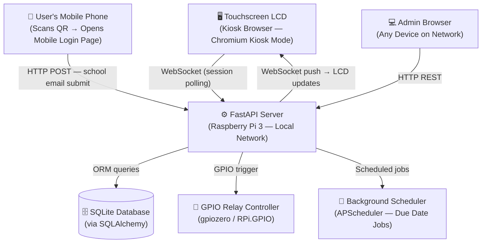
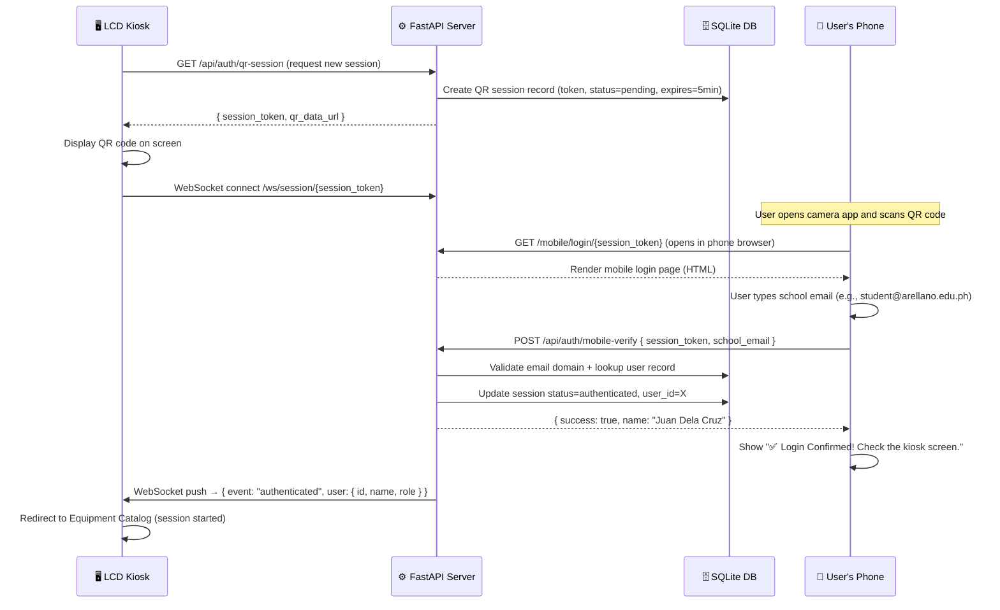
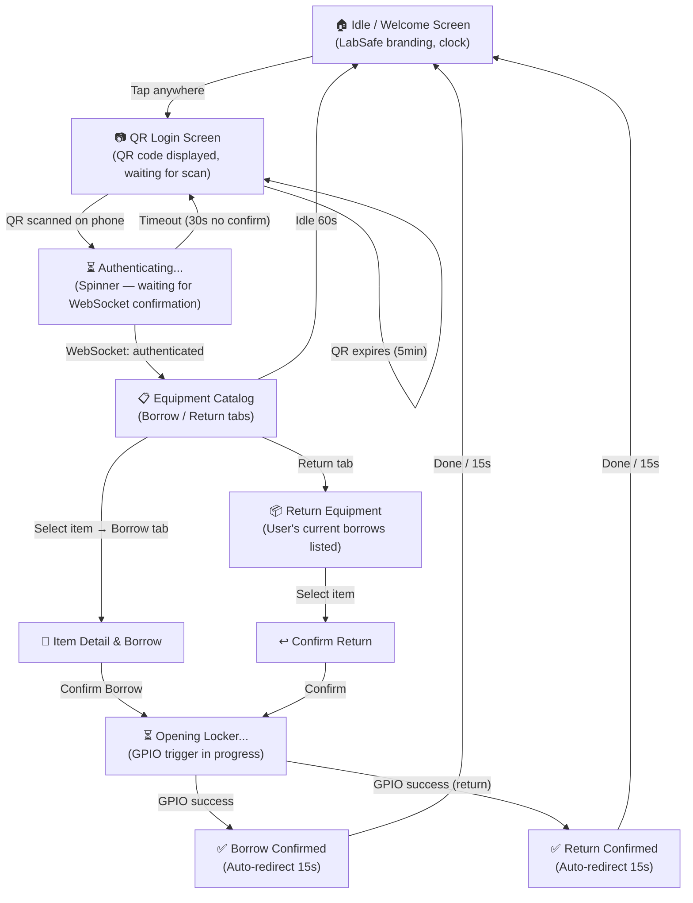
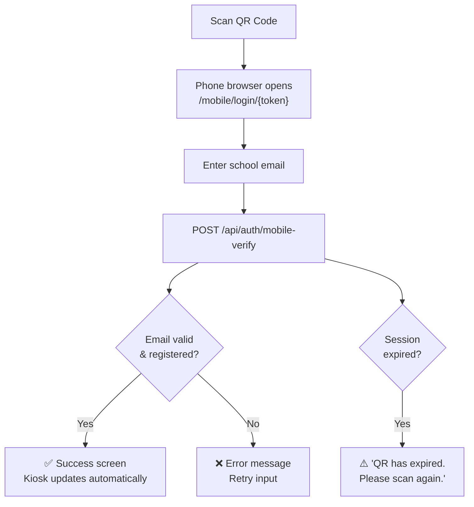
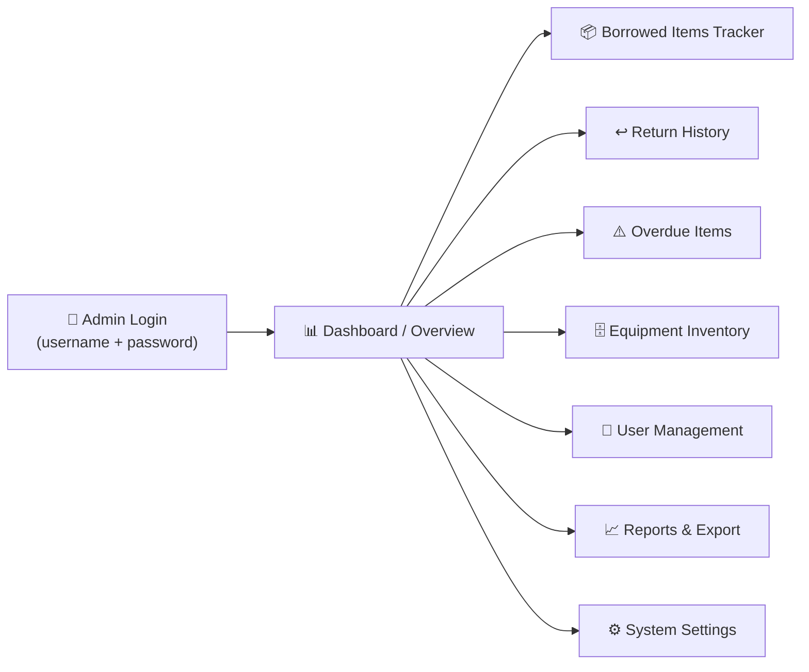
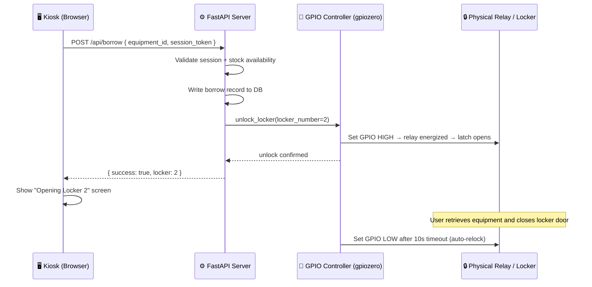
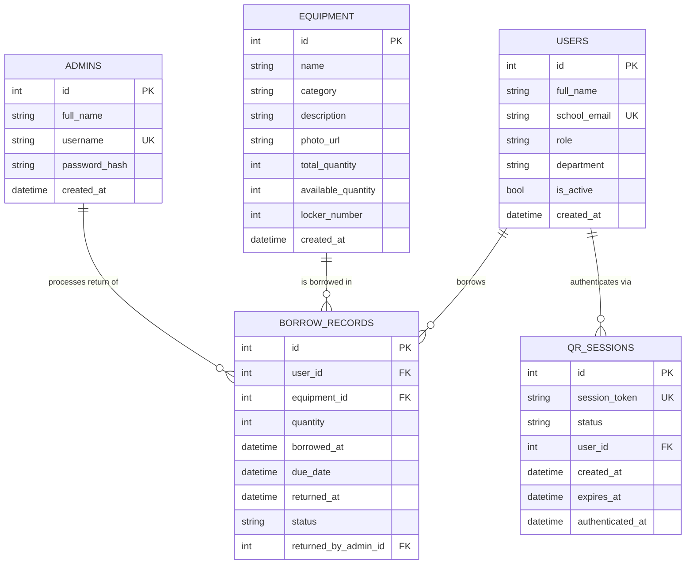

# LabSafe Smart Locker System — Project Specification

> **Client:** Arellano University Malabon  
> **Document Version:** 1.1  
> **Date:** November 2026  
> **Status:** Draft for Review  
> **Changelog v1.1:** Locked tech stack to Python/FastAPI; replaced PIN login with QR code + mobile school email auth flow.

---

## Table of Contents

1. [Project Overview](#1-project-overview)
2. [System Architecture](#2-system-architecture)
3. [Technology Stack](#3-technology-stack)
4. [Design System](#4-design-system)
5. [QR Code Login Flow](#5-qr-code-login-flow)
6. [Kiosk Web Application (User-Facing)](#6-kiosk-web-application-user-facing)
7. [Mobile Login Web Page](#7-mobile-login-web-page)
8. [Admin Web Dashboard](#8-admin-web-dashboard)
9. [Hardware Integration](#9-hardware-integration)
10. [Database Schema](#10-database-schema)
11. [API Specification](#11-api-specification)
12. [Non-Functional Requirements](#12-non-functional-requirements)
13. [Out of Scope](#13-out-of-scope)
14. [Glossary](#14-glossary)

---

## 1. Project Overview

### 1.1 Background

**LabSafe** is an automated smart-locker system for laboratory equipment management, powered by a **Raspberry Pi 3**. The system controls physical locker units and provides a fully digital borrowing and returning workflow for laboratory equipment at Arellano University Malabon.

The solution replaces manual logbooks and manual key-based cabinet systems, improving accountability, traceability, and security of lab equipment.

### 1.2 Goals

| # | Goal |
|---|------|
| G1 | Allow students/faculty to borrow lab equipment without manual intervention from laboratory staff |
| G2 | Authenticate users frictionlessly via QR code scan on their personal mobile phone |
| G3 | Automatically track who borrowed what, when, and when it's due for return |
| G4 | Notify administrators of overdue, borrowed, and returned equipment |
| G5 | Provide a kiosk-style interface suitable for a touchscreen LCD in a lab environment |
| G6 | Provide admins a full tracking dashboard accessible from any device |

### 1.3 Users

| Role | Description |
|------|-------------|
| **Student / Faculty (Borrower)** | Uses their phone to scan the kiosk QR code and authenticate with their school email; then interacts with the kiosk touchscreen to borrow/return equipment |
| **Lab Administrator** | Uses the admin dashboard to monitor borrows, returns, due dates, and manage equipment inventory |
| **System (Automated)** | Raspberry Pi running background jobs for locker control and due-date monitoring |

---

## 2. System Architecture



### 2.1 Deployment Model

- The **FastAPI server** runs on the **Raspberry Pi 3** (local network, port 8000).
- A **React (Vite) SPA** is served as static files by FastAPI — it powers both the kiosk and admin views via different routes.
- The **Kiosk** runs Chromium in `--kiosk` mode pointed at `http://localhost:8000/kiosk`.
- The **mobile login page** is a lightweight HTML page served at a unique session URL accessible from the same Wi-Fi network.
- The **Admin Dashboard** is at `http://<pi-ip>:8000/admin`, accessible from any browser on the network.
- All data is stored locally on the Raspberry Pi in an SQLite file.

> [!IMPORTANT]
> The mobile login page **requires the user's phone to be on the same Wi-Fi network** as the Raspberry Pi (the lab's local network). No internet connection is needed.

---

## 3. Technology Stack

### 3.1 Confirmed Stack (Python-first)

| Layer | Technology | Rationale |
|-------|-----------|-----------|
| **Backend / API** | **FastAPI** (Python 3.11+) | Native Python; async support; easy GPIO integration; auto-generated OpenAPI docs |
| **Frontend (Kiosk + Admin)** | **React 18 + Vite** | Fast build; lightweight for Pi; served as static files from FastAPI |
| **UI Styling** | **Tailwind CSS** | Utility-first; large touch targets easy to implement |
| **Real-time / Push** | **WebSockets** (via FastAPI `websockets`) | LCD screen listens for session events pushed from server |
| **Database** | **SQLite** via **SQLAlchemy** (async) | Zero-config, file-based, Pi-friendly |
| **Migrations** | **Alembic** | Schema version control |
| **QR Code Generation** | **`qrcode`** Python library | Generates session QR codes server-side |
| **Authentication** | **JWT** (`python-jose`) + school email validation | Stateless tokens; email domain whitelist (e.g., `@arellano.edu.ph`) |
| **Password / PIN Hashing** | **`passlib[bcrypt]`** | Admin login security |
| **GPIO / Hardware** | **`gpiozero`** + **`RPi.GPIO`** | Standard Pi libraries for relay control |
| **Background Jobs** | **APScheduler** | In-process scheduler for due-date checks and auto-relock |
| **HTTP Client (Mobile page)** | Vanilla JS + `fetch` | No framework needed for the simple mobile auth page |
| **Runtime** | Python 3.11 (ARM64) | Well-supported on Raspberry Pi 3 |
| **Process Manager** | **`systemd`** service | Auto-start FastAPI on Pi boot |
| **Display** | **Chromium** in `--kiosk` mode | Native Pi OS kiosk support |

### 3.2 Key Python Libraries Summary

```
fastapi
uvicorn[standard]
sqlalchemy[asyncio]
aiosqlite
alembic
python-jose[cryptography]
passlib[bcrypt]
qrcode[pil]
gpiozero
RPi.GPIO
apscheduler
python-multipart
Pillow
```

---

## 4. Design System

### 4.1 Brand Colors — Arellano University Malabon

| Token | Hex | Usage |
|-------|-----|-------|
| `--au-blue` | `#003087` | Primary buttons, headers, navigation bar |
| `--au-blue-light` | `#0052CC` | Hover/active states |
| `--au-red` | `#C8102E` | Alerts, overdue badges, destructive actions |
| `--au-red-light` | `#E63950` | Hover on destructive buttons |
| `--au-white` | `#FFFFFF` | Card backgrounds, kiosk content areas |
| `--au-gray-100` | `#F4F5F7` | Page background |
| `--au-gray-600` | `#6B7280` | Secondary text, metadata |
| `--au-gold` | `#F5A623` | Warning states (e.g., "due soon") |
| `--au-green` | `#16A34A` | Success states, "Available" badges |

### 4.2 Typography

| Use | Font | Weight |
|-----|------|--------|
| Headings | Poppins | 700 |
| Body | Inter | 400 |
| Labels / Buttons | Inter | 600 |
| Monospace (IDs, QR tokens) | JetBrains Mono | 400 |

### 4.3 Kiosk UX Principles

- **Minimum touch target size:** 48×48 px (follows WCAG 2.5.5)
- **Font sizes:** Minimum 18px body, 24px+ for primary actions
- **High contrast** between text and background (AU Blue on White, White on AU Blue)
- **Idle screen timeout:** Return to QR login screen after **60 seconds** of inactivity
- **No hover-dependent interactions** — everything must work via tap/touch
- **Large, clearly labeled buttons** (McDonald's kiosk style: full-width CTA cards)
- **QR code must be clearly visible** — minimum 250×250 px, centered, with high contrast border

---

## 5. QR Code Login Flow

> [!NOTE]
> This is the core authentication mechanism. No password or PIN is typed on the kiosk itself. The user authenticates entirely on their personal phone, and the kiosk updates automatically via WebSocket.

### 5.1 Full Login Sequence



### 5.2 QR Session Rules

| Rule | Detail |
|------|--------|
| **Session Expiry** | QR code expires after **5 minutes** of no scan |
| **Auto-refresh** | Kiosk auto-generates a new QR if the current one expires |
| **One-time use** | Each QR session token is single-use; invalidated after successful login |
| **Email Validation** | Only `@arellano.edu.ph` (or admin-configured domain) emails are accepted |
| **Unknown Email** | If email is not registered in DB → show error on phone: *"Account not found. Contact your lab administrator."* |
| **Session Timeout** | Authenticated kiosk session expires after **60 seconds of inactivity** |
| **Concurrent Sessions** | Only one active session per kiosk display at a time |

### 5.3 QR Code Contents

The QR code encodes a URL that opens directly on the user's phone browser:

```
http://<raspberry-pi-local-ip>:8000/mobile/login/<session_token>
```

Example:
```
http://192.168.1.50:8000/mobile/login/eyJhbGci...
```

> [!WARNING]
> The Pi's local IP address must be **static** (set via DHCP reservation or manual IP config) so the QR code URL is always valid.

---

## 6. Kiosk Web Application (User-Facing)

### 6.1 Screen Flow



### 6.2 Screens

#### 6.2.1 Idle / Welcome Screen
- **LabSafe logo** and **Arellano University Malabon** branding (AU Blue header)
- Large **"TAP TO BEGIN"** button
- Current date and time display
- Idle animation / subtle background

#### 6.2.2 QR Login Screen
- Instruction text: *"Scan this QR code with your phone camera to log in"*
- **QR code** — large, centered (minimum 280×280 px), white background, AU Blue border
- Session expiry countdown timer (e.g., *"QR refreshes in 4:23"*)
- QR auto-regenerates on expiry with a brief animation
- "Back" button → returns to Idle screen

#### 6.2.3 Authenticating Screen
- Spinning loader (AU Blue)
- Message: *"Waiting for confirmation from your phone…"*
- Transitions automatically to Catalog on WebSocket auth event
- Times out after **30 seconds** → returns to QR screen with message: *"Login timed out. Please scan the QR code again."*

#### 6.2.4 Equipment Catalog
| Element | Description |
|---------|-------------|
| Header | Logged-in user's name + "Logout" button |
| Tabs | "**Borrow**" and "**Return**" (large touch tabs) |
| Item Cards | Equipment photo thumbnail, name, category, availability badge |
| Filter Bar | Filter by category (Glassware, Tools, Instruments, etc.) |
| Search | On-screen tap keyboard for text search |
| Availability Badge | Green "Available (N)" or Red "Unavailable" |

#### 6.2.5 Item Detail & Borrow
- Full equipment name, photo, description
- Available quantity indicator
- **Quantity selector** (large `+` / `−` buttons)
- **Due Date selector** — card-style preset buttons: "1 Day", "3 Days", "1 Week"
- **"Confirm Borrow"** CTA (AU Blue, full-width, large)
- **"Cancel"** secondary button

#### 6.2.6 Opening Locker Screen (Shared for Borrow & Return)
- Loading spinner animation
- Message: *"Opening Locker #[N] — please wait…"*
- GPIO relay triggered by server
- Error screen if relay fails to respond within **10 seconds**

#### 6.2.7 Borrow Confirmation Screen
- Large ✅ success animation
- Summary card: Item name, qty borrowed, due date, locker number
- Reminder: *"Please close the locker securely after taking your item."*
- Auto-redirect to Idle after **15 seconds** or "Done" button

#### 6.2.8 Return Equipment Screen
- Lists the logged-in user's currently borrowed items
- Each row: item name, qty, borrow date, due date, overdue badge if applicable
- Checkbox or card-tap selection for items to return
- "Confirm Return" CTA button

#### 6.2.9 Return Confirmation Screen
- Large ✅ success animation
- Summary of returned items
- If returned late → AU Red banner: *"This item was returned [N] days late."*
- Auto-redirect to Idle after **15 seconds**

---

## 7. Mobile Login Web Page

> [!NOTE]
> This is a **simple, lightweight web page** — not a full app. It is served by the FastAPI server and opened in the user's phone browser when they scan the QR code.

### 7.1 Page Design
- Full-screen, centered card layout
- AU Blue and White color scheme
- **LabSafe logo** at top
- Instruction: *"Enter your Arellano University school email to log in"*
- **Email input field** (large, touch-friendly, type=email)
- **"Confirm Login"** button (AU Blue, full-width)
- After submission: success state → *"✅ Logged in! You may now use the kiosk."*
- Error state: *"❌ Email not found. Contact your lab administrator."*
- Error state: *"❌ Invalid email domain. Use your @arellano.edu.ph email."*

### 7.2 Mobile Page Flow



---

## 8. Admin Web Dashboard

> [!IMPORTANT]
> The admin dashboard is accessible from **any browser on the local network** at `http://<pi-ip>:8000/admin`. It uses standard username + password login (not the QR flow). It is **not** designed for the kiosk touchscreen.

### 8.1 Admin Screen Map



### 8.2 Admin Features

#### 8.2.1 Dashboard Overview
- Summary cards:
  - Total items currently borrowed
  - Total items overdue
  - Items returned today
  - Total registered users
  - Total equipment types
- Recent activity feed (live-updating via polling or WebSocket)
- Quick-action: "Show Overdue Only"

#### 8.2.2 Borrowed Items Tracker

| Column | Description |
|--------|-------------|
| Borrower Name | Full name of student/faculty |
| School Email | Registered email |
| Equipment Name | Name of the borrowed item |
| Quantity | Units borrowed |
| Borrow Date | Timestamp |
| Due Date | Expected return |
| Status | `Borrowed` / `Overdue` / `Returned` |
| Action | View details, Mark as returned (manual override) |

- Sortable and filterable columns
- Color-coded rows: Blue (Borrowed), Red (Overdue), Green (Returned)
- Pagination (25 / 50 / 100 rows per page)

#### 8.2.3 Return History
- Full log of all completed returns
- Columns: Borrower, Item, Borrowed On, Returned On, Duration, On Time (Yes/No)
- Searchable by name, item, or date range

#### 8.2.4 Overdue Items Panel
- Dedicated view filtered to only overdue records
- Shows *"X days past due"* label
- Urgency color-coding: Yellow (1–2 days), Red (3+ days)

#### 8.2.5 Equipment Inventory Management
- Add, edit, delete equipment
- Fields: Name, Category, Description, Photo upload, Total Quantity, Locker Number Assignment
- Manual stock adjustment (increment/decrement with reason log)
- Low-stock threshold alerts

#### 8.2.6 User Management
- Add, edit, deactivate student/faculty accounts
- Fields: Full Name, School Email, Role (Student / Faculty), Department, Is Active
- Bulk import via CSV (columns: full_name, school_email, role, department)
- No PIN/password needed for borrowers — they authenticate via school email QR flow

#### 8.2.7 Reports & Export
- Generate reports by date range
- Export formats: **PDF**, **CSV**
- Report types:
  - Borrow frequency per item
  - Most active borrowers
  - Overdue history
  - Return compliance rate

#### 8.2.8 System Settings
- Allowed email domain(s) for QR login (e.g., `arellano.edu.ph`)
- QR session expiry duration (default: 5 minutes)
- Due date presets (editable: label + days)
- Kiosk idle timeout duration
- Locker configuration (number of lockers, locker-to-equipment mapping)
- Admin account management (add/remove admin users)

---

## 9. Hardware Integration

### 9.1 Raspberry Pi 3 GPIO Mapping

| Component | GPIO Pin (BCM) | Description |
|-----------|---------------|-------------|
| Locker Relay 1 | GPIO 17 | Opens/closes locker unit 1 |
| Locker Relay 2 | GPIO 27 | Opens/closes locker unit 2 |
| Locker Relay 3 | GPIO 22 | Opens/closes locker unit 3 |
| *(additional relays)* | GPIO 5, 6, 13… | One GPIO per locker unit |
| Status LED (Green) | GPIO 24 | System ready indicator |
| Status LED (Red) | GPIO 25 | Error / locker fault indicator |
| Buzzer (optional) | GPIO 23 | Audio feedback on borrow/return events |
| LCD Touch Display | DSI / HDMI | 7-inch official Pi touchscreen recommended |

### 9.2 Locker Control Flow



### 9.3 GPIO Python Module (Design Outline)

```python
# hardware/locker_controller.py
from gpiozero import OutputDevice
import asyncio

LOCKER_PINS = {
    1: 17,
    2: 27,
    3: 22,
    # extend as needed
}

async def unlock_locker(locker_number: int, duration_seconds: int = 10):
    """Activate relay for locker_number, hold for duration, then relock."""
    pin = LOCKER_PINS[locker_number]
    relay = OutputDevice(pin, active_high=False)  # active_low for most relay boards
    relay.on()
    await asyncio.sleep(duration_seconds)
    relay.off()
```

### 9.4 Kiosk Mode Setup (Chromium)

```bash
# /etc/xdg/lxsession/LXDE-pi/autostart
@chromium-browser --noerrdialogs --disable-infobars --kiosk http://localhost:8000/kiosk
```

- Right-click disabled via JavaScript event interception
- Browser navigation controls hidden from user
- Screen rotation configured via `/boot/config.txt` for vertical mounting

---

## 10. Database Schema

### 10.1 Entity Relationship Diagram



### 10.2 Field Reference

**`QR_SESSIONS.status`**

| Value | Description |
|-------|-------------|
| `pending` | QR shown on LCD, waiting for phone scan |
| `scanned` | Phone opened the mobile login page |
| `authenticated` | Email confirmed, user logged in |
| `expired` | Session expired before authentication |
| `invalidated` | Manually cancelled or replaced |

**`BORROW_RECORDS.status`**

| Value | Description |
|-------|-------------|
| `borrowed` | Item is currently out |
| `overdue` | Past due date, not yet returned |
| `returned` | Item has been returned on time |
| `returned_late` | Returned after the due date |

---

## 11. API Specification

### 11.1 QR Auth Endpoints

| Method | Endpoint | Description |
|--------|----------|-------------|
| `GET` | `/api/auth/qr-session` | Generate a new QR session token + QR image for the kiosk |
| `GET` | `/mobile/login/{session_token}` | Serve the mobile login HTML page |
| `POST` | `/api/auth/mobile-verify` | Verify school email and authenticate the QR session |
| `GET` | `/api/auth/session-status/{token}` | Poll session status (fallback if WebSocket unavailable) |
| `POST` | `/api/auth/logout` | Invalidate current kiosk session |

### 11.2 Kiosk API Endpoints

| Method | Endpoint | Description |
|--------|----------|-------------|
| `GET` | `/api/equipment` | List all equipment with availability |
| `GET` | `/api/equipment/{id}` | Get single equipment detail |
| `POST` | `/api/borrow` | Create borrow record + trigger locker unlock |
| `GET` | `/api/borrow/my` | Get current user's active borrows |
| `POST` | `/api/return` | Mark item(s) as returned + trigger locker |

### 11.3 WebSocket Endpoint

| Endpoint | Description |
|----------|-------------|
| `WS /ws/session/{session_token}` | Kiosk connects here; server pushes auth events |

**Events pushed to kiosk:**

```json
{ "event": "authenticated", "user": { "id": 1, "name": "Juan Dela Cruz", "role": "student" } }
{ "event": "session_expired" }
{ "event": "locker_opened", "locker": 2 }
{ "event": "locker_error", "message": "Relay timeout" }
```

### 11.4 Admin API Endpoints

| Method | Endpoint | Description |
|--------|----------|-------------|
| `POST` | `/api/admin/auth/login` | Admin login (username + password → JWT) |
| `GET` | `/api/admin/dashboard` | Aggregated stats |
| `GET` | `/api/admin/borrows` | All borrow records (filterable, paginated) |
| `GET` | `/api/admin/borrows/overdue` | Only overdue records |
| `PATCH` | `/api/admin/borrows/{id}/return` | Manual return override |
| `GET` | `/api/admin/equipment` | Equipment list |
| `POST` | `/api/admin/equipment` | Add equipment |
| `PATCH` | `/api/admin/equipment/{id}` | Edit equipment |
| `DELETE` | `/api/admin/equipment/{id}` | Delete equipment |
| `GET` | `/api/admin/users` | List all borrower users |
| `POST` | `/api/admin/users` | Add user |
| `PATCH` | `/api/admin/users/{id}` | Edit user |
| `POST` | `/api/admin/users/import` | Bulk import users via CSV |
| `GET` | `/api/admin/reports` | Generate report (params: `type`, `from`, `to`, `format`) |
| `GET` | `/api/admin/settings` | Get system settings |
| `PATCH` | `/api/admin/settings` | Update system settings |

### 11.5 Hardware Control Endpoints (Internal Only)

| Method | Endpoint | Description |
|--------|----------|-------------|
| `POST` | `/api/hardware/unlock` | Trigger locker unlock (called internally by borrow/return logic) |
| `GET` | `/api/hardware/status` | Get status of all locker relays |

---

## 12. Non-Functional Requirements

| Category | Requirement |
|----------|-------------|
| **Performance** | Kiosk screens must load within **2 seconds** on Raspberry Pi 3 (1GB RAM) |
| **QR Responsiveness** | WebSocket auth event must reach the kiosk LCD within **1 second** of mobile email submission |
| **Offline Capability** | Core kiosk borrow/return must function on **local network only** — no internet dependency |
| **Reliability** | System must recover gracefully after power loss (auto-start via `systemd`) |
| **Security** | Admin passwords hashed with bcrypt; JWT tokens for admin sessions; QR session tokens are single-use and time-limited |
| **Email Domain Enforcement** | Only whitelisted email domains (e.g., `@arellano.edu.ph`) accepted during QR login |
| **Accessibility** | Touch targets ≥ 48px; high contrast; large font sizes on kiosk |
| **Scalability** | Support up to **500 users**, **100 equipment types**, **10 locker units** in v1.0 |
| **Data Backup** | Daily automated SQLite database backup to external USB or SD secondary partition |
| **Uptime** | Target **99% uptime** during lab operating hours (6am–9pm) |

---

## 13. Out of Scope

The following are **explicitly excluded** from v1.0:

- ❌ Native mobile application (iOS/Android) — mobile login is a browser page only
- ❌ Payment / fine collection system
- ❌ Email or SMS notifications *(considered for v2.0)*
- ❌ Barcode / RFID scanning *(considered for v2.0)*
- ❌ Cloud/remote deployment *(local network only for v1.0)*
- ❌ Multi-campus support
- ❌ Integration with the university's existing SIS (Student Information System)
- ❌ OTP / two-factor authentication on mobile login *(considered for v2.0)*

---

## 14. Glossary

| Term | Definition |
|------|-----------|
| **Kiosk App** | The user-facing React SPA displayed fullscreen on the touchscreen LCD |
| **Mobile Login Page** | A lightweight web page served to the user's phone after scanning the QR code |
| **QR Session** | A temporary, single-use authentication session represented by a QR code on the LCD |
| **Admin Dashboard** | The management web interface for lab administrators |
| **Borrow Record** | A database entry tracking who borrowed what equipment and when |
| **Due Date** | The deadline by which a borrower must return equipment |
| **Overdue** | A borrow record where the due date has passed without return |
| **GPIO** | General Purpose Input/Output — hardware pins on the Raspberry Pi used to control relays |
| **Relay** | An electronically controlled switch that opens/closes the physical locker latch |
| **Kiosk Mode** | A Chromium configuration that runs fullscreen with no navigation UI exposed |
| **WebSocket** | A persistent two-way connection between the kiosk browser and the server for real-time events |
| **APScheduler** | Python library used for in-process background scheduling (due date checks, auto-relock) |
| **LabSafe** | The name of the smart-locker product prototype |

---

## Appendix A — Project Directory Structure

```
labsafe/
├── backend/
│   ├── main.py                  # FastAPI app entrypoint
│   ├── config.py                # Settings (email domain, timeouts, etc.)
│   ├── database.py              # SQLAlchemy async engine + session
│   ├── models/
│   │   ├── user.py
│   │   ├── equipment.py
│   │   ├── borrow_record.py
│   │   ├── qr_session.py
│   │   └── admin.py
│   ├── schemas/                 # Pydantic request/response schemas
│   ├── routers/
│   │   ├── auth.py              # QR session + mobile verify endpoints
│   │   ├── kiosk.py             # Equipment catalog, borrow, return
│   │   ├── admin.py             # Admin dashboard endpoints
│   │   └── hardware.py          # GPIO locker control
│   ├── hardware/
│   │   └── locker_controller.py # gpiozero GPIO logic
│   ├── services/
│   │   ├── qr_generator.py      # QR code image generation
│   │   ├── scheduler.py         # APScheduler due-date jobs
│   │   └── websocket_manager.py # WebSocket connection manager
│   ├── migrations/              # Alembic migration files
│   └── requirements.txt
│
├── frontend/
│   ├── src/
│   │   ├── kiosk/               # Kiosk-specific screens & components
│   │   │   ├── IdleScreen.jsx
│   │   │   ├── QRLoginScreen.jsx
│   │   │   ├── CatalogScreen.jsx
│   │   │   ├── BorrowScreen.jsx
│   │   │   └── ReturnScreen.jsx
│   │   ├── admin/               # Admin dashboard pages
│   │   │   ├── Dashboard.jsx
│   │   │   ├── BorrowTracker.jsx
│   │   │   ├── Inventory.jsx
│   │   │   └── UserManagement.jsx
│   │   ├── mobile/              # Mobile login page (minimal)
│   │   │   └── MobileLogin.jsx
│   │   └── App.jsx
│   ├── tailwind.config.js
│   ├── vite.config.js
│   └── package.json
│
└── README.md
```

---

## Appendix B — Raspberry Pi 3 Setup Checklist

- [ ] Install Raspberry Pi OS (64-bit Desktop)
- [ ] Set **static local IP address** (required for QR code URL)
- [ ] Install Python 3.11+ and `pip`
- [ ] Install all backend Python dependencies (`pip install -r requirements.txt`)
- [ ] Install Node.js 20 LTS + npm (for building the React frontend)
- [ ] Build React frontend (`npm run build`) and place output in `backend/static/`
- [ ] Run Alembic migrations (`alembic upgrade head`)
- [ ] Configure `systemd` service for FastAPI/Uvicorn auto-start on boot
- [ ] Install Chromium browser
- [ ] Configure `autostart` to launch Chromium in kiosk mode pointing to `http://localhost:8000/kiosk`
- [ ] Wire relay board to GPIO pins per locker mapping
- [ ] Test GPIO relay triggering with a test script
- [ ] Test touchscreen calibration
- [ ] Set up daily cron job for database backup
- [ ] Test full QR login flow end-to-end (phone + LCD)

---

*Document prepared for Arellano University Malabon LabSafe Prototype — v1.1*  
*For questions, contact the development team lead.*
